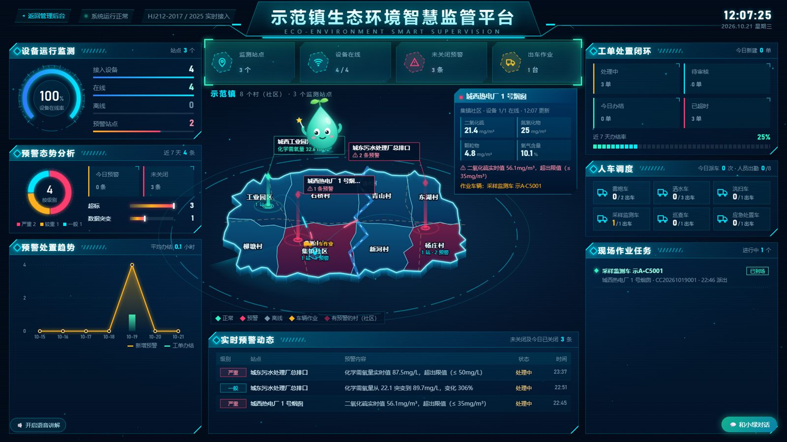
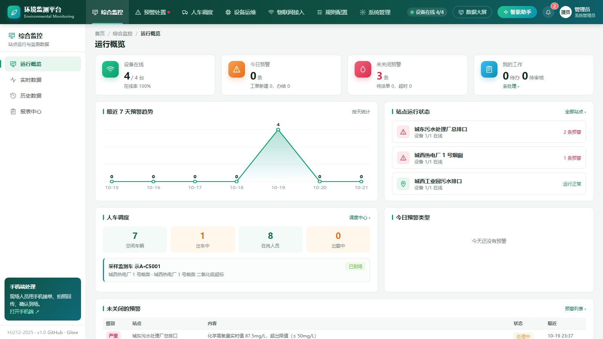
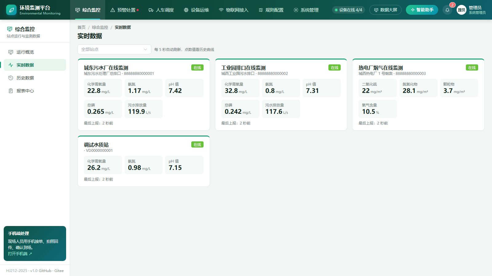
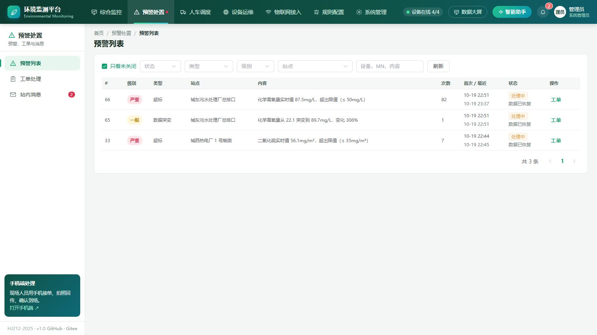
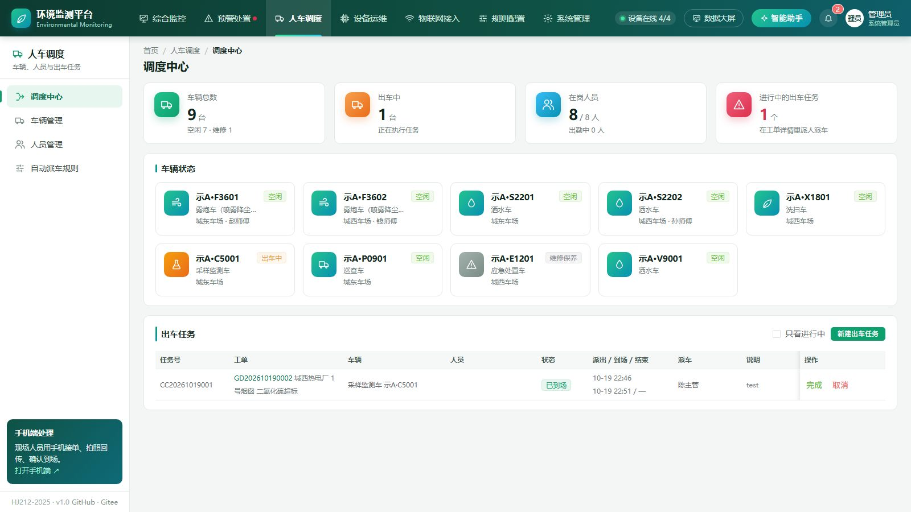
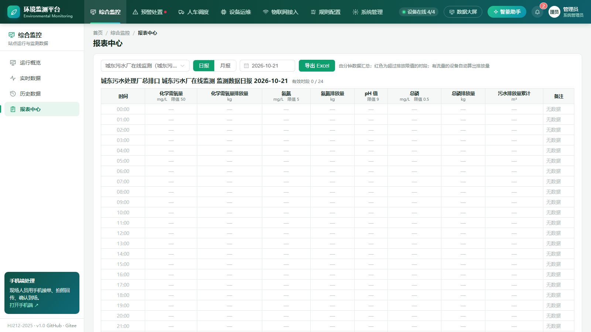
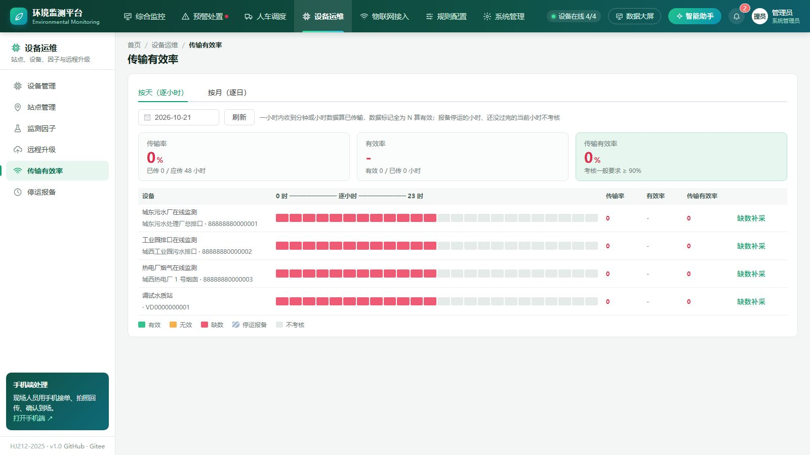
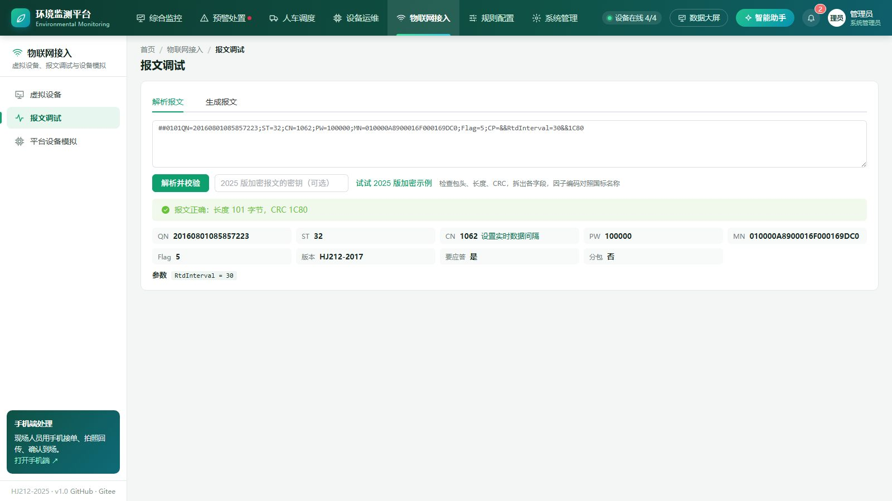
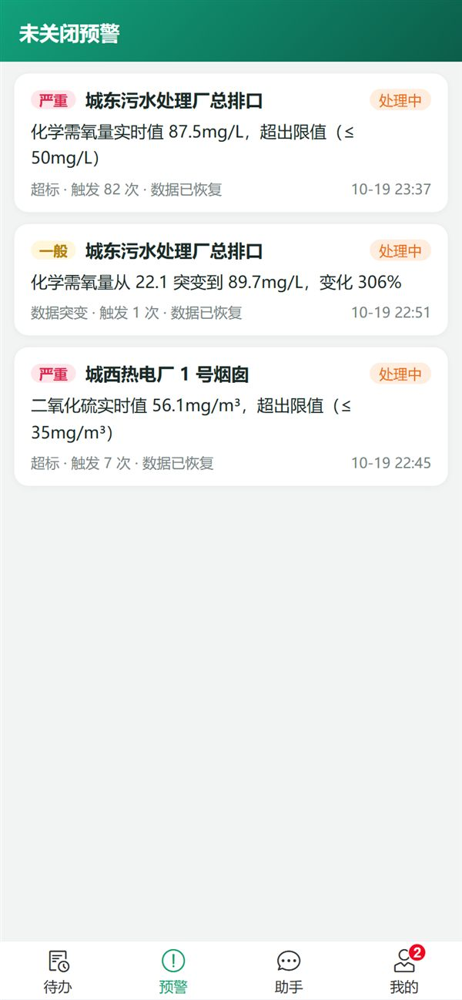

# 环境监测平台（开源基础版）

基于 HJ212-2017 / HJ212-2025 的环境在线监测平台：数采仪通过 TCP 上报数据，平台校验入库、超标自动预警，预警派给站点负责人处理，审核人审核，全程留痕，钉钉群机器人实时提醒。还有一个能用大白话查数据的智能助手。

自带 HJ212 设备模拟器，没有硬件也能把"上报 → 预警 → 派单 → 通知 → 处理 → 审核"整个流程跑起来。

## 在线体验

演示站：<https://env.xiaowuiot.com>（完整版，模拟设备一直在上报数据）

| 入口 | 地址 |
|---|---|
| 管理后台 | <https://env.xiaowuiot.com/> |
| 手机端（处理人拍照提交） | <https://env.xiaowuiot.com/m/> |
| 数据大屏（讲解员「小绿」） | <https://env.xiaowuiot.com/screen/> |

体验账号，密码都是 `demo123`，登录页也可以一键登录：

| 账号 | 角色 | 可以体验 |
|---|---|---|
| `chen` | 陈主管，审核员 | 派单、审核、停产报备、考核报表 |
| `zhang` | 张工，处理人（城东） | 手机端接单、拍照提交 |
| `liu` / `wang` | 刘工 / 王工，处理人（城西） | 同上 |
| `ops` | 吴工，运维 | 站点、设备、因子管理，缺数补采，虚拟设备 |
| `fleet` | 郑队长，车队调度 | 人员、车辆、派车、自动派车规则 |

演示站的自带数据受保护：可以新建站点、设备、车辆等自己的数据随意改删，自带的演示数据不能修改和删除，也不能改密码。

代码仓库：GitHub <https://github.com/xiaowu-iot/env-monitor> ，Gitee 镜像 <https://gitee.com/xiaowu-iot/env-monitor>

## 界面截图

截图来自完整版（和演示站一样）。开源版包含其中的实时数据、预警派单处理审核等基础功能，具体区别见下面的对照表。

**数据大屏**：乡镇地图、站点光柱、预警动态、工单闭环、人车调度，讲解员「小绿」可以语音讲解



| 运行概览 | 实时数据 |
|---|---|
|  |  |
| **预警列表** | **调度中心** |
|  |  |
| **报表中心** | **传输有效率** |
|  |  |
| **报文调试** | **手机端（处理人）** |
|  |  |

## 开源版和完整版

这个仓库是开源基础版，拉下来就能跑通上面的完整流程。

| 功能 | 开源版 | 完整版 |
|---|:---:|:---:|
| HJ212-2017 数据接收：实时、分钟、小时、日数据，CRC 校验，9014 应答，半包粘包处理 | ✅ | ✅ |
| HJ212-2025 接入：版本自动识别（2005 / 2017 / 2025 混接）、SM4 加密报文解密、要求加密传输、心跳包、补传标志、3 位数据标记 | ✅ | ✅ |
| HJ212-2025 数采仪激活（1001 / 1002）、密钥自动更新（1014）、新增命令（2013、2062、3022、3024……）、现场端上报信息 | | ✅ |
| 设备管理、未登记设备提示、原始报文查看、实时数据看板、历史曲线 | ✅ | ✅ |
| 超标预警（上下限），同类预警合并、数据恢复标记 | ✅ | ✅ |
| 预警派给站点负责人、手动派单、处理、审核（通过 / 驳回），流转记录 | ✅ | ✅ |
| 钉钉群机器人（加签）、站内消息、内置钉钉模拟接口 | ✅ | ✅ |
| 智能助手：大白话查运行情况、预警、设备、实时和历史数据、待办 | ✅ | ✅ |
| 设备模拟器（正常、超标） | ✅ | ✅ |
| 登录记录、操作记录：谁在什么时候、从哪个端、做了什么，成功失败都记 | ✅ | ✅ |
| HJ212 全部命令：参数设置、提取历史数据、反控（校准、采样、清洗、留样……）、分包、超时重发 | | ✅ |
| 远程升级（OTA）：固件管理、批量升级、进度跟踪、离线设备上线自动升级 | | ✅ |
| 离线、数据恒值、数据突变、设备故障预警；连续 N 次触发；超时未处理自动升级 | | ✅ |
| 分配规则：按区域 / 站点 / 预警类型 / 级别派单，按角色负载均衡，转派、处理时限、超时提醒 | | ✅ |
| 多个钉钉群、按事件订阅、消息模板、发送记录和重发 | | ✅ |
| 权限点自由组合角色、按区域划分数据范围 | | ✅ |
| 智能助手一句话派单、处理、审核、下发命令、升级（确认后执行），预警原因分析，日报周报 | | ✅ |
| 手机端处理页：拍照提交、审核、语音问智能助手 | | ✅ |
| 模拟器全场景（离线、恒值、突变、故障、命令应答、远程升级） | | ✅ |
| 人车调度：雾炮车、洒水车等车辆和外勤人员台账，工单里派人派车，自动派车规则，调度中心 | | ✅ |
| 数据传输有效率考核（逐小时、月度热力图）、缺数一键补采、停产检修报备、监测数据日报月报和排放量导出 | | ✅ |
| 数据大屏：乡镇地图（可换自己的镇界）、站点光柱和飞线、讲解员「小绿」轮播讲解和对话操作大屏、真人音色播报 | | ✅ |
| 物联网接入：虚拟设备连任意 HJ212 服务器、实时报文监视、报文解析和生成 | | ✅ |
| 手机号脱敏和验证码查看、拍照水印、工单短信通知 | | ✅ |
| MySQL 建表语句、部署方案、HJ212 对接说明、系统讲解文档 | | ✅ |

完整版源码、建表语句和系统讲解文档放在知识星球「小物学长的物联网实战营」里，会按专题讲这个项目是怎么一步步做出来的：<https://t.zsxq.com/hldoY>

## 快速开始

环境：JDK 17+、Maven 3.6+。

```bash
git clone https://github.com/xiaowu-iot/env-monitor.git
cd env-monitor
mvn clean package -DskipTests
java -jar env-server/target/env-monitor.jar --env.simulator.auto-start=true
```

浏览器打开 <http://localhost:8070/>。数采仪连 TCP 9212 端口。

第一次启动会生成：

- 管理员 `admin`，随机密码在 `data/initial-admin.txt`
- 演示数据：3 个站点、3 台设备、7 条超标规则
- 演示账号（密码 `demo123`）：`chen` 陈主管（审核员）、`zhang` 张工 和 `liu` 刘工（处理人），登录页可以一键登录

`--env.simulator.auto-start=true` 会让 3 台设备的模拟器跟着启动。

## 走一遍完整流程

1. 管理员登录，打开「设备模拟器」，把"城东污水厂在线监测"的场景切到"超标"
2. 十几秒后「预警列表」出现 COD 超标预警，自动派给站点负责人张工，审核人陈主管
3. 「钉钉通知」页能看到模拟群收到的派单消息，@ 了张工，加签校验通过
4. 模拟器切回"正常"，预警标记"数据已恢复"
5. 张工登录，在「工单处理」里打开工单，填写处理结果，提交审核
6. 陈主管登录，驳回或通过；驳回后张工重新提交
7. 工单详情里的流转记录完整记录了每一步

热电厂站点故意没配负责人，超标后预警停在"待派单"，陈主管会收到站内消息，在预警列表里手动派单。

## 接入钉钉

钉钉群 → 设置 → 机器人 → 添加机器人 → 自定义，安全设置选"加签"。把 Webhook 和 SEC 开头的密钥写到 jar 同目录的 `config/application.yml`：

```yaml
env:
  dingtalk:
    webhook: https://oapi.dingtalk.com/robot/send?access_token=你的 token
    secret: SEC 开头的密钥
```

启动时加 `--spring.config.additional-location=optional:file:./config/`。用户的手机号填了，消息里会 @ 到人。

## 智能助手接入大模型

默认是规则模式，常用问法都能识别。接入任意支持工具调用的 OpenAI 兼容接口（DeepSeek、通义千问、本地 Ollama 等）后，可以用更自由的说法提问：

```yaml
env:
  ai:
    provider: openai
    base-url: https://api.deepseek.com/v1
    api-key: 你的 API Key
    model: deepseek-chat
```

常用的几家（都是 OpenAI 兼容接口，key 在各家开放平台申请）：

| 模型 | base-url | model |
|---|---|---|
| DeepSeek | `https://api.deepseek.com/v1` | `deepseek-chat` |
| 通义千问 | `https://dashscope.aliyuncs.com/compatible-mode/v1` | `qwen-plus` |
| Kimi | `https://api.moonshot.cn/v1` | `moonshot-v1-8k` |
| 智谱 | `https://open.bigmodel.cn/api/paas/v4` | `glm-4-flash` |
| 本地 Ollama | `http://127.0.0.1:11434/v1` | 本地拉取的模型名 |

没配 key 时智能助手是规则模式，只回答常用问法，聊天窗口里会提示怎么配置。

智能助手按当前登录用户的权限调用查询工具，不会编造数据。

## 命令行模拟器

```bash
java -jar env-simulator/target/env-simulator-0.1.0-SNAPSHOT-exec.jar --host 127.0.0.1 --port 9212 --count 5 --type water --interval 10
```

| 参数 | 默认 | 说明 |
|---|---|---|
| `--count` | 1 | 设备数量 |
| `--type` | water | `water` 水（COD、氨氮、pH、总磷、流量）或 `gas` 气（SO₂、NOx、颗粒物、氧含量） |
| `--interval` | 30 | 实时数据间隔（秒） |
| `--minute-interval` | 60 | 分钟数据间隔（秒） |
| `--mn-prefix` | 8888888000 | MN 前缀，后面补序号 |
| `--password` | 123456 | 访问密码 |
| `--scenario` | NORMAL | NORMAL 或 OVER_LIMIT |
| `--version` | 2017 | 协议版本，`2025` 按 HJ212-2025 上报（Flag=9、心跳包） |
| `--key` | | 2025 版通信密钥（16 位），填了就加密上报，要和平台上登记的一致 |

平台里没登记的 MN 会在「设备管理」顶部提示，可以一键登记。

## 配置

| 配置 | 默认 | 说明 |
|---|---|---|
| `server.port` | 8070 | 后台端口 |
| `env.hj212.port` | 9212 | HJ212 TCP 端口 |
| `env.hj212.ack-data` | true | 收到要求应答的数据回 9014 |
| `env.hj212.key-secret` | 自动生成 | 2025 版设备密钥加密保存用的主密钥（16 位），不填在 data 目录生成 hj212-master.key，要备份 |
| `env.device.offline-timeout-seconds` | 300 | 多久没报文判离线 |
| `env.dingtalk.webhook` / `secret` | 内置模拟群 | 钉钉群机器人 |
| `env.ai.provider` | mock | `mock` 规则模式，`openai` 接大模型 |
| `env.init.demo-data` | true | 首次启动生成演示数据 |
| `env.demo.protect` | false | 公开演示站打开：开启时已有的数据普通账号不能改删，不能改密码、管账号；每天凌晨备份数据库到 `data/backup` |
| `env.data-dir` | ./data | 数据目录（H2 数据库、初始管理员密码） |

## 项目结构

```
env-server/libs/env-hj212.jar   HJ212 编解码（2005 / 2017 / 2025）：报文解析与组装、CRC、SM4 加解密、Netty 切帧（半包粘包）。以内置 jar 提供
env-simulator/   数采仪模拟器：命令行和平台内置共用
env-server/      平台
  ingest/        TCP 服务端、会话、报文处理、原始报文
  device/        设备、在线状态、因子字典
  data/          监测数据入库、最新值、历史查询
  alarm/         超标规则、预警判断
  order/         派单、工单流转、流转记录
  notify/        钉钉机器人、站内消息、钉钉模拟接口
  agent/         智能助手：查询工具、规则模式、大模型调用
  sim/ report/ user/ security/ site/ config/
  resources/static/   管理后台（Vue 3 + Element Plus），不需要构建
```

技术栈：Spring Boot 3.5、Netty 4.1、Spring Data JPA、Spring Security、H2；前端 Vue 3 + Element Plus。

## 测试

```bash
mvn test
```

- `env-hj212`：标准附录示例报文的 CRC、解析和组装、半包粘包、CRC 错误、长度错误
- `FullFlowTest`：真实 TCP + HTTP 端到端：模拟器上报 → 超标预警 → 派给站点负责人 → 钉钉加签通知 → 越权被拒 → 提交 → 驳回 → 再提交 → 审核通过；没有负责人的站点手动派单
- `AgentTest`：智能助手规则模式的常用问法，大模型模式的工具调用
- `DemoGuardTest`：演示数据保护

## 想系统学、做完整的平台？

这个仓库是**基础版**：HJ212 接入、超标预警、派单审核、钉钉通知和模拟器，够你把整个流程跑通。

[在线演示站](https://env.xiaowuiot.com)跑的是完整版。完整版源码、建表语句和系统讲解文档都在知识星球 **「小物学长的物联网实战营」** 里。我在星球的《项目实战 · 环境监测平台》专栏里，从项目骨架讲到部署上线，再到 HJ212-2025 新标准接入，一共 21 讲：

| 内容 | 仓库（基础版） | 实战营 |
|---|:---:|:---:|
| HJ212 编解码、TCP 接入、数据入库、设备模拟器 | ✅ | ✅ 逐步讲解 |
| 超标预警、派单审核、钉钉通知、智能助手查询 | ✅ | ✅ 逐步讲解 |
| HJ212 全部命令、反控、分包、超时重发、远程升级（OTA） | | ✅ |
| HJ212-2025 新标准：SM4 加密、密钥管理、数采仪激活、新增命令 | 加密接入 | ✅ 逐步讲解 |
| 离线 / 恒值 / 突变 / 故障预警，分配规则、超时升级 | | ✅ |
| 人车调度：雾炮车、洒水车派车，自动派车规则 | | ✅ |
| 传输有效率考核、缺数补采、停产报备、日报月报 | | ✅ |
| 数据大屏：乡镇地图、讲解员「小绿」语音讲解和对话操作 | | ✅ |
| 手机端拍照提交、短信通知、手机号脱敏、物联网接入工具 | | ✅ |
| MySQL 建表语句、部署方案、答疑 | | ✅ |

👉 加入方式：[知识星球「小物学长的物联网实战营」](https://t.zsxq.com/hldoY)，或者关注公众号「**小物学长**」，回复【星球】。

公众号回复【速查】可以领取《IoT 协议速查手册》PDF。

<p align="center">
  <br>
  微信扫码关注公众号「小物学长」
</p>

其他开源项目：[iot-protocol-gateway](https://github.com/xiaowu-iot/iot-protocol-gateway)（JT/T 808、HJ212 设备接入网关）、[ai-inspection](https://github.com/xiaowu-iot/ai-inspection)（AI 安全巡检）

## 参与贡献

欢迎提交 Issue 和 PR。如果你手上有真实数采仪的报文样例（请脱敏后再提交），对完善协议兼容性帮助很大。

## 许可证

[AGPL-3.0](LICENSE)。修改后对外提供服务需要按 AGPL 开放源码；想闭源商用，可以通过公众号联系获取商业授权。
